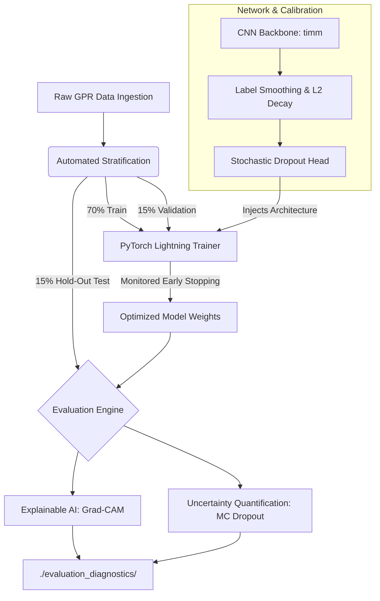
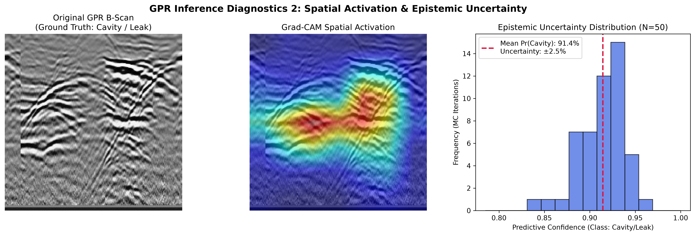
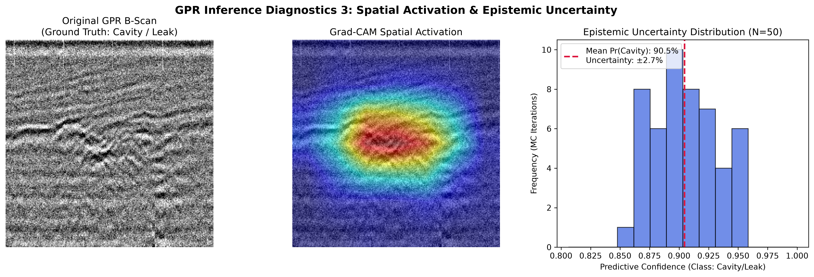
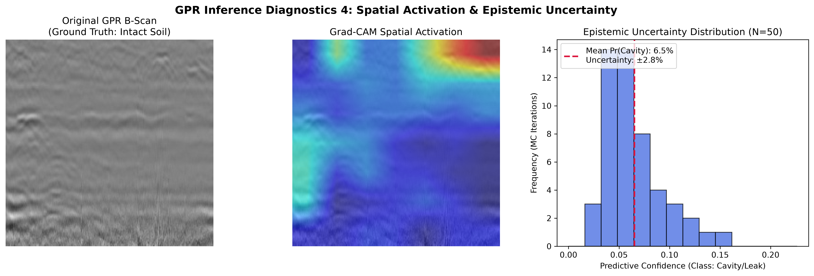
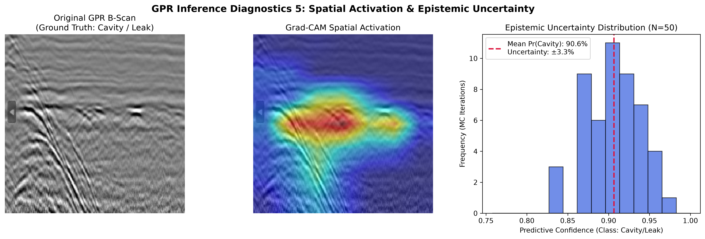

# Deep-GPR: Trustworthy AI for Subsurface Utility and Leak Detection

## Abstract
This repository contains a production-ready Machine Learning Operations (MLOps) pipeline designed for the automated condition assessment of critical urban subsurface infrastructure. By utilizing deep Convolutional Neural Networks (CNNs) on Ground Penetrating Radar (GPR) radargrams, the system autonomously identifies structural anomalies such as cavities and water leaks. To fulfill the strict safety and reliability requirements of high-stakes civil engineering applications, this pipeline operationalizes a **Trustworthy AI** framework. It establishes empirical model reliability through **Explainable AI (Grad-CAM)** for spatial attention mapping and **Uncertainty Quantification (Monte Carlo Dropout)** to measure epistemic model variance.

## 1. Dataset Attribution
The GPR B-scans utilized in this pipeline are sourced from a peer-reviewed, open-access repository representing varying subsurface strata and structural anomalies.

**Dataset Reference:**
> MOJAHID, Abdelaziz; EL OUAI, Driss; EL AMRAOUI, Khalid; EL HAMI, Khalil; AITBENAMER, Hamou (2024), “Intelligent recognition of subsurface utilities and voids: A Ground Penetrating Radar dataset for Deep Learning applications”, *Mendeley Data*, V1.  
> **DOI:** [10.17632/ww7fd9t325.1](https://doi.org/10.17632/ww7fd9t325.1)  
> **URL:** [Mendeley Dataset Portal](https://data.mendeley.com/datasets/ww7fd9t325/1)

## 2. System Architecture & Tech Stack

This framework implements a modern MLOps architecture, ensuring deterministic reproducibility, automated hardware allocation, and strict experimental isolation to prevent data leakage.

*   **Training Framework:** PyTorch Lightning
*   **Architecture Backbone:** `timm` (Torch Image Models)
*   **Configuration Management:** `OmegaConf` (YAML-based hyperparameter control)
*   **Data Integrity:** `scikit-learn` (Stratified Sampling)



## 3. Methodology

### 3.1 Data Engineering & Stratification
To maintain rigorous experimental integrity, the ingestion pipeline dynamically routes the raw data into a **Stratified 3-way Split** (70% Train, 15% Validation, 15% Test). The validation set governs the automated Early Stopping callback to prevent overfitting, while the final evaluation metrics and visualizations are derived *exclusively* from the unseen test set.

### 3.2 Network Calibration
The deep learning classifier is heavily calibrated to prevent the mathematical overconfidence commonly observed in standard neural network architectures:
*   **Label Smoothing ($\alpha = 0.15$):** Restricts logit extremes, discouraging the model from predicting with absolute (1.0) certainty, thereby softening the target distributions.
*   **Weight Decay (L2 Regularization):** Penalizes disproportionate network weights to ensure generalizability across varying soil permittivity profiles.
*   **Early Stopping:** Actively monitors validation loss, halting the training phase at the optimal generalization threshold.

### 3.3 Trustworthy AI Framework
Black-box models are unacceptable in civil infrastructure assessment. This pipeline evaluates model trustworthiness on two fronts:
1.  **Explainable AI (Grad-CAM):** Gradient-weighted Class Activation Mapping reverse-engineers the target convolutional layers. It proves visually that the model utilizes actual geophysical structures (e.g., hyperbolic diffraction patterns) for inference, rather than background artifact noise.
2.  **Epistemic Uncertainty Quantification (MC Dropout):** Dropout mechanisms are forced to remain active during the inference phase. By executing $N=50$ forward passes per image, the system records the predictive variance, establishing a statistically sound margin of error (Epistemic Uncertainty) for every prediction.

## 4. Execution Guide

### Dependencies
It is highly recommended to run this project inside a Python virtual environment (e.g., `venv` or `conda`). Install all required dependencies using the provided `requirements.txt` file:

```bash
pip install -r requirements.txt


### Pipeline Workflow
1.  **Configure:** Edit `config.yaml` and update the `paths` dictionary to point to your extracted Mendeley datasets.
2.  **Prepare:** Run the data engineering script to stratify and route the raw radargrams.
    ```bash
    python 1_data_prep.py
    ```
3.  **Train:** Execute the PyTorch Lightning trainer. Optimal weights will be auto-saved to `./checkpoints`.
    ```bash
    python 2_train.py
    ```
4.  **Evaluate:** Generate the Trustworthy AI Diagnostics against the unseen test set. This script automatically samples 5 distinct test cases (across both Cavity and Intact classes) and compiles the results into a dedicated `./evaluation_diagnostics/` folder.
    ```bash
    python 3_evaluate.py
    ```

## 5. Diagnostic Outputs & Results Gallery

The following diagnostic profiles verify the model's reliability on unseen test data. Each profile compiles the original geophysical B-Scan, the spatial attention (Grad-CAM), and the Monte Carlo probabilistic variance histogram.

*(Note: Isolated high-resolution Grad-CAM spatial activation heatmaps for each result are also available in the `evaluation_diagnostics/` directory).*

### Set 1: Intact Soil Assessment
_aug_10.png)

### Set 2: Cavity / Leak Detection


### Set 3: Cavity / Leak Detection


### Set 4: Intact Soil Assessment


### Set 5: Cavity / Leak Detection
