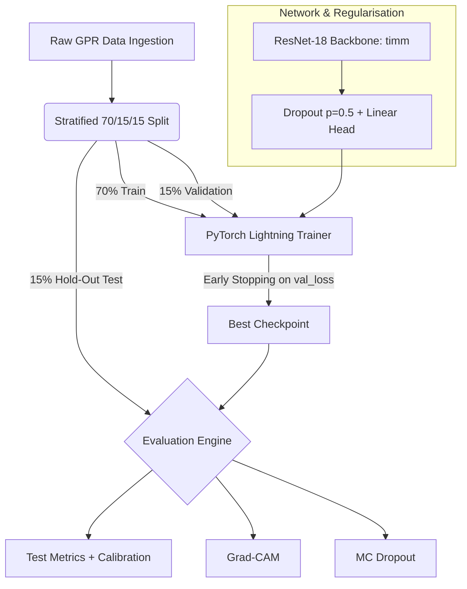

# Deep-GPR: Explainable, Uncertainty-Aware Classification of GPR B-scans for Subsurface Leak and Cavity Detection

> Research prototype on a public dataset.

## Abstract
This repository contains a reproducible, config-driven PyTorch Lightning pipeline that classifies Ground Penetrating Radar (GPR) B-scans as *cavity / leak* or *intact soil*. An ImageNet-pretrained ResNet-18 is fine-tuned on a public GPR dataset, and two diagnostics are layered on top: **Grad-CAM** attention maps to inspect which regions drive each prediction, and **Monte Carlo Dropout** to obtain a spread of predictions for every scan. The aim is to explore trustworthy, interpretable model outputs for condition assessment of buried water infrastructure.

## 1. Dataset Attribution
The GPR B-scans come from a peer-reviewed, open-access repository.

> MOJAHID, Abdelaziz; EL OUAI, Driss; EL AMRAOUI, Khalid; EL HAMI, Khalil; AITBENAMER, Hamou (2024), "Intelligent recognition of subsurface utilities and voids: A Ground Penetrating Radar dataset for Deep Learning applications", *Mendeley Data*, V1.
> **DOI:** [10.17632/ww7fd9t325.1](https://doi.org/10.17632/ww7fd9t325.1)
> **URL:** [Mendeley Dataset Portal](https://data.mendeley.com/datasets/ww7fd9t325/1)

The input folders (`augmented_cavities`, `augmented_intact`) contain 1,453 pre-augmented images derived from about 154 distinct source scans (file names such as `cavity_leak_41_aug_8`).

## 2. System Architecture & Tech Stack
*   **Training framework:** PyTorch Lightning
*   **Backbone:** `timm` ResNet-18, ImageNet-pretrained, with a dropout + linear 2-class head
*   **Configuration:** `OmegaConf` (YAML hyperparameters)
*   **Splitting:** `scikit-learn` stratified sampling
*   **Explainability:** `pytorch-grad-cam`



## 3. Methodology

### 3.1 Data splitting
Images are split **70 / 15 / 15** (train / validation / test), stratified by class, with a fixed seed (`random_state=42`). The validation set drives early stopping and checkpoint selection; test results are computed on the held-out split.

### 3.2 Training and regularisation
*   Fine-tuning from ImageNet weights; AdamW, learning rate 1e-4; input resized to 224 × 224
*   **Label smoothing (0.15)** to keep predictions conservative; for two classes it moves the target for the true class to about 0.925
*   **Dropout (p = 0.5)** in the classification head and **weight decay** (1e-3)
*   **Early stopping** on validation loss (patience 3, max 15 epochs)

### 3.3 Diagnostics
1.  **Grad-CAM** on the final residual block of ResNet-18, for the predicted class. The heatmaps are used as a qualitative check that attention falls on reflection structures such as hyperbolic diffraction patterns.
2.  **Monte Carlo Dropout:** dropout is kept active at inference and N = 50 stochastic forward passes are run per scan. The reported uncertainty is the standard deviation of the predicted probability across passes. Because dropout sits in the classification head, it reflects head-level variability.

## 4. Results
Held-out test split, deterministic evaluation (`python 4_check_and_metrics.py`), positive class = cavity / leak.

| Metric | Value |
|---|---|
| Test images | 218 (83 cavity / leak, 135 intact) |
| Accuracy | 0.9954 |
| Precision (cavity / leak) | 1.0000 |
| Recall (cavity / leak) | 0.9880 (82 of 83) |
| F1 (cavity / leak) | 0.9939 |
| Expected Calibration Error (10 bins) | 0.0806 |
| Mean predicted confidence | 0.915 |

*Evaluation scope:* the split is made at image level on pre-augmented files, so test images share source scans with the training set (218 / 218). These figures therefore describe in-distribution performance and are not an estimate for unseen scans or surveys. Mean confidence (0.915) sits below accuracy (0.995), consistent with label smoothing keeping the model conservative.

## 5. Execution Guide

```bash
pip install -r requirements.txt
```

1.  **Configure:** edit `config.yaml` so `paths.raw_cavity`, `paths.raw_intact` and `paths.processed_data` point to your local data.
2.  **Prepare:** `python 1_data_prep.py`
3.  **Train:** `python 2_train.py` (best weights are saved to `./checkpoints`)
4.  **Metrics:** `python 4_check_and_metrics.py` (test metrics, calibration and split-overlap report)
5.  **Diagnostics:** `python 3_evaluate.py` samples 5 test images at random (seed 42) and writes Grad-CAM and MC Dropout figures to `./evaluation_diagnostics/`.

## 6. Scope and Next Steps
This is a proof of concept on public data. Planned extensions:
*   **Source-grouped splitting** (e.g. `StratifiedGroupKFold` on the file name before `_aug_`) so evaluation reflects unseen scans.
*   **Field data and domain shift:** validation on real survey data with heterogeneous soil conditions.
*   **Calibrated uncertainty:** reliability diagrams, deep ensembles and conformal prediction alongside MC Dropout.
*   **Finer outputs:** separating water leaks from air voids, and quantitative validation of Grad-CAM localisation.
*   **Training reproducibility:** fixed training seeds and deterministic flags.

## 7. Diagnostic Outputs Gallery
Each profile shows the B-scan, the Grad-CAM map and the MC Dropout distribution for a test image.

### Set 1: Intact Soil Assessment
_aug_10.png)

### Set 2: Cavity / Leak Detection


### Set 3: Cavity / Leak Detection


### Set 4: Intact Soil Assessment


### Set 5: Cavity / Leak Detection

